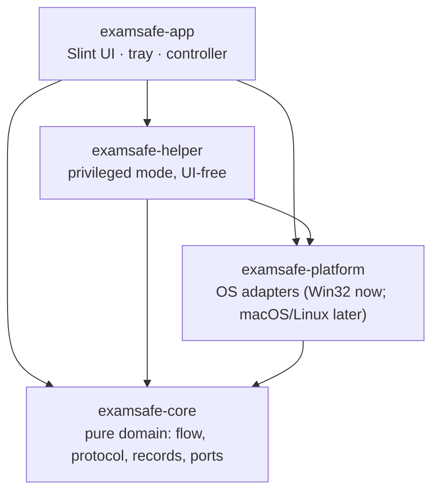

# ExamSafe — Architecture

> Product design and reasoning: [IDEA.md](IDEA.md). This file covers how the code is organised
> and the rules that keep it that way.

## Layers



| Crate | Responsibility | May depend on | Must never depend on |
|---|---|---|---|
| `examsafe-core` | Exam flow state machine, catalog + app matching + close/restore rules (`apps`), services and scheduled tasks: matching, journal snapshots, pause/restore plans, verification, never-touch lists (`system`), read-only inventory types (`inventory`), Advanced rows (`advanced`), application service (`service`), helper protocol, exam-mode journal, **ports** (traits) | serde, thiserror | UI, OS APIs, other ExamSafe crates |
| `examsafe-platform` | Implements the ports for the current OS: process control (list / describe incl. command line + folder / polite close / force close / relaunch via the desktop Explorer), system inventory (services, scheduled tasks, startup items, listening ports, network adapters), applying service/task changes (helper only), elevation, storage, helper client. **Only place with `unsafe`**, confined to `*_impl.rs` | core, `windows` | UI, app, helper |
| `examsafe-helper` | Privileged mode (library): one request in (command line), one response out, then exit. The app exe runs it when started as `ExamSafe.exe --helper --request <hex>`, before any UI exists. Actions: `Ping`, `ApplyChanges` (service start type + state, task enabled; protected items refused) | core, platform | UI |
| `examsafe-app` | Slint UI (`ui/*.slint`), tray, controller (window), `cli` (same flow without a window) | everything above | — |

Enforced by [`tools/check-architecture.ps1`](../tools/check-architecture.ps1) (dependency
rules + `unsafe` exemptions) and by workspace lints (`unsafe_code = "deny"`,
`unwrap_used`/`expect_used` warn, clippy warnings are errors).

## Key patterns

- **Pure state machine.** `core::flow::Flow` takes `Event`s and returns `Effect`s. The app's
  controller executes effects and feeds results back as events. All transitions, including
  failure and retry, are unit tested without a UI.
- **Ports and adapters.** Core defines `ExamModeRepository` and `PrivilegedExecutor`; platform
  implements them. Tests (and future macOS/Linux ports) plug in different implementations.
- **Journal first.** `Effect::BeginExamMode` is always emitted *before* `Effect::RunFix`, and the
  controller stops executing effects when one fails, so nothing changes before it is recorded.
- **One service, two front-ends.** `core::service::run_effect` does the real work for every flow
  effect. The window (on a worker thread) and `ExamSafe.exe --cli` both call it, so they cannot
  drift apart — and the CLI doubles as the end-to-end test harness.
- **Journal, then helper, then verify.** Services and scheduled tasks are snapshotted in the
  journal (start type incl. delayed start, running state / enabled) before one helper run pauses
  them (tasks first, then services: start type, then stop). Only journaled items are ever changed;
  a retry keeps the first snapshot. Restore runs the exact recorded state back through the helper
  and re-reads to prove it. Each change states its full end state, so retries are harmless.
- **Never touched.** Security software and exam software are excluded in core
  (`system::is_protected_*`) and refused again inside the helper.
- **Restore exactly.** Apps are recorded with their root process's arguments, folder and whether
  they had a window; restore starts them the same way (hidden if they had no window) through the
  desktop Explorer, so they run as the normal user and not as ExamSafe's child.
- **Close politely, then force.** Apps first get WM_CLOSE on their main windows (like clicking X),
  then a grace period (4 s), then are force-closed. The user confirms the list first.
- **Presentation-only UI.** `.slint` files contain layout, styling and animation only. Tokens
  (colours, type, motion) live in `ui/theme.slint`; nothing else hard-codes a colour.
- **Least privilege, one exe.** The app never runs as admin. For privileged work it relaunches
  its own executable through UAC in helper mode (`--helper`), which is dispatched in `main` before
  any window or tray exists. The request is passed on the command line (fixed at launch, cannot be
  swapped); the response path is validated by the helper. One portable exe, and the UAC prompt
  names ExamSafe itself.

## Testing

| Level | Where | In `tools/check.ps1` |
|---|---|---|
| Unit — domain | `examsafe-core` (`flow`, `protocol`, `exam_mode`, `steps`) | ✓ |
| Unit — flow + service with a fake OS | `core::service` tests drive make-safe → restore end to end against `FakeControl`, `FakeInventory` and `FakeHelper` (services + tasks: journal, pause order, delayed start, retry, declined UAC, left-alone items) | ✓ |
| Integration — real Windows | `examsafe-platform` (list, describe incl. command line + folder, terminate a real process; read real services, tasks, ports, adapters, startup items; polite close of a real window is `--include-ignored`) | ✓ (window test manual) |
| Unit — adapters | file store round-trip, corrupt file, helper arg parsing | ✓ |
| **End to end — real exe, real apps** | `tools/e2e-charmap.ps1`: Character Map + a background ping it starts itself; checks arguments, folder and windowless state come back exactly, and nothing already running is started twice | manual |
| **End to end — services and tasks** | `tools/e2e-services.ps1`: creates its own test task and do-nothing test service (Automatic, delayed), make-safe → disabled/stopped → restore → exactly as before, then removes both. Task part runs as a normal user; service part needs an admin terminal | manual |
| Unit — app | tray icon rendering | ✓ |
| Architecture | `tools/check-architecture.ps1` | ✓ |
| Performance | `tools/measure.ps1` (startup, RAM, idle CPU) | manual |
| UI (headless) | `examsafe-app/src/ui_tests.rs`: texts, button labels, enabled state and actions per phase via Slint's testing backend and accessibility labels (needs element debug info, enabled for debug builds in `build.rs`) | ✓ |

The gate runs locally (there is no hosted CI): `tools/check.ps1` runs fmt, clippy with
warnings as errors, all tests and the architecture check, and fails if any of them fails.

```bash
pwsh ./tools/check.ps1        # add -Fix to apply rustfmt
```

## Portable build

```bash
pwsh ./tools/build-portable.ps1
```

Produces `dist/ExamSafe.exe`: a single self-contained exe (~9 MB), no installer. State lives in
`%LOCALAPPDATA%\ExamSafe`, not next to the exe.

## Running

```bash
cargo run -p examsafe-app
```

Environment overrides (for development and tests):
`EXAMSAFE_CATALOG=<file>` uses another catalog; `EXAMSAFE_STATE_DIR=<dir>` keeps the journal
elsewhere so tests never touch the real one; `EXAMSAFE_HELPER=direct` runs the helper without a
UAC prompt (with the caller's own rights).

Command line: `ExamSafe.exe --cli scan | inventory | make-safe --yes | restore | status`. The exam-mode record lives at `%LOCALAPPDATA%\ExamSafe\exam-mode.json`;
delete it to reset.

## Current scope (2026-10-20)

**Changed and restored:** apps (closed politely then forced, reopened with their original
arguments, folder and window state), Windows services (exact start type incl. delayed start, and
running state) and scheduled tasks (enabled state), all journaled first and re-verified.
**Shown only (Advanced / `--cli inventory`):** startup items, listening ports, network adapters
(VPN/virtual flagged). **Not handled yet:** browser extensions, IDE/OS AI settings, adapters,
startup entries — the UI says so.
